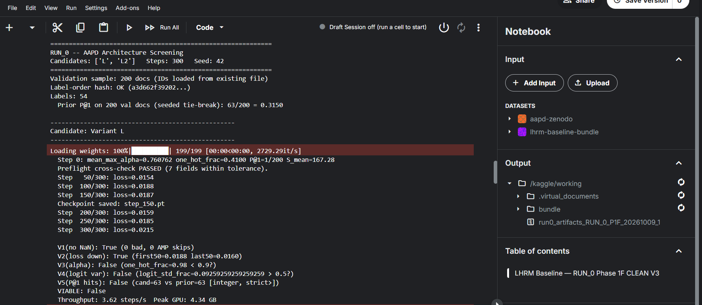
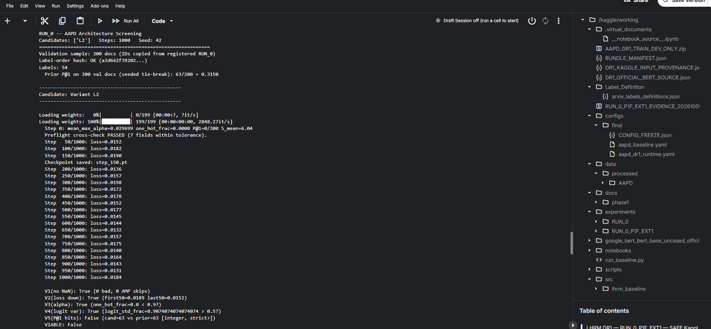
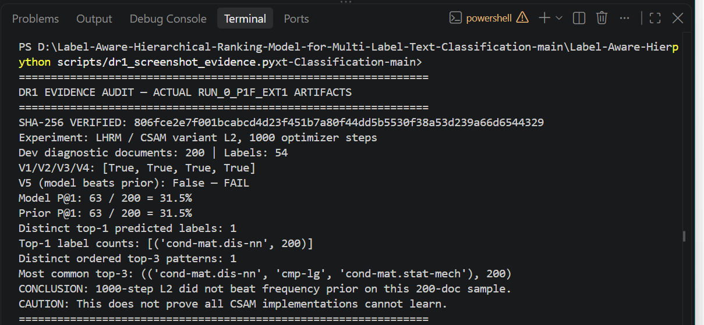

# Label-Aware Hierarchical Ranking Model (LHRM)

> [!IMPORTANT]
> **LHRM R_AUTHOR V1.0 RESEARCH & CLIENT INFERENCE RELEASE (2026-10-15)**  
> This repository contains the audited, reproducible **V1.0 release** of the Label-Aware Hierarchical Ranking Model under the author-aligned architecture (**Variant R_AUTHOR**). All training (15 epochs, 100,950 optimizer steps), validation selection (Epoch 6, Step 40,380), independent frozen Test evaluation (1,000 documents, Neural-Only), and verified client inference workflows (Kaggle and Google Colab) are fully integrated and documented.
>
> **Key Scientific Results on AAPD**:
> - **Frozen Independent Test P@1**: **84.90%** (0.8490)
> - **Frozen Independent Test Micro-F1**: **72.78%** (0.727787, TP=1671, FP=500, FN=750)
> - **Frozen Independent Test Macro-F1**: **55.53%** (0.555253)
> - **Dev Model Selection P@1**: **89.50%** (0.8950 on 400-doc selection split; Full Dev P@1 = 0.8760)
> - **Selected Checkpoint**: `best_dev_model_only.pt` (Epoch 6 / Step 40,380 | SHA-256: `988bb64fca2b8ea21030585de7268a1cfb1fc8676b91b4d6e6f38c4f22c95643`)
> - **HRRM Held-Out Finding**: GBDT re-ranking exhibited a slight negative delta on held-out Dev ($\Delta P@1 = -0.005$, $\Delta 	ext{Micro-F1} = -0.0009$). Preserving fail-closed scientific integrity, HRRM was **not evaluated or deployed on the Test set**.
>
> Detailed results, full 54-label breakdown, and audit documentation: [`docs/results/R_AUTHOR_AAPD_V1_RESULTS.md`](docs/results/R_AUTHOR_AAPD_V1_RESULTS.md)  
> Machine-readable data: [`docs/results/test_summary_metrics.json`](docs/results/test_summary_metrics.json) | [`docs/results/test_per_label_metrics_54.csv`](docs/results/test_per_label_metrics_54.csv) | [`docs/results/epoch_metrics.csv`](docs/results/epoch_metrics.csv) | [`docs/results/hrrm_heldout_comparison.json`](docs/results/hrrm_heldout_comparison.json)  
> Open research backlog: [`docs/experiments/RESEARCH_BACKLOG.md`](docs/experiments/RESEARCH_BACKLOG.md)

## Research Objective
Multi-label text classification requires predicting multiple labels for a document. Existing approaches often treat labels independently. The LHRM architecture aims to map document text embeddings and label description embeddings into the same representation space using a Contextual Similarity Attention Module (CSAM), establishing dependencies before final ranking.

## Original Paper and Attribution
- **Authors:** Lama Ayash, Abdulmohsen Algarni, and Omar Alqahtani
- **Journal:** IEEE Access (2025)
- **DOI:** 10.1109/ACCESS.2025.11129041
- **Original Source Repository:** [LamaAy/Label-Aware-Hierarchical-Ranking-Model-for-Multi-Label-Text-Classification](https://github.com/LamaAy/Label-Aware-Hierarchical-Ranking-Model-for-Multi-Label-Text-Classification)

## Subsequent Engineering and Experimental Contributions
This repository builds upon the original client implementation by adding significant rigor and reproducibility pipelines:
- Complete end-to-end reproducibility auditing.
- Isolation of test sets to prevent data leakage.
- Independent standard Multi-Label BERT baseline implementation.
- GPU / Kaggle-ready environment packaging.
- Deterministic evaluation protocols (P@k, nDCG@k, F1).
- Controlled structural screening and architectural ablations.

## Current Architecture Variants
The source tree supports several architecture options:
- **Variant L**: The literal, paper-faithful CSAM implementation explicitly mapping Eqs. 4-8.
- **Variant L2**: A controlled stabilization of `L` incorporating $\frac{1}{\sqrt{H}}$ scaling to the document-label similarity computation.
- **Variant L2_A5B**: An alternative architectural interpretation parameterizing an unshared classifier weight $W \in \mathbb{R}^{k \times H}$ with shared scalar bias $b \in \mathbb{R}$, retaining label-label self-attention.
- **Variant B**: A standard independent BERT control (`[CLS] -> Linear(54)`) utilizing BCEWithLogitsLoss.
- **Variant L2_NO_SA**: A prepared isolated mathematical ablation removing label-label self-attention.
- **Variant R**: A repository-style fallback CSAM using concat aggregation.
- **Variant R_AUTHOR**: An isolated, author-code-aligned recovery implementation faithful to the authors' reference repository (`Model/lhrm.py`). Combines BERT document `pooler_output`, precomputed trainable label embeddings (`nn.Parameter` initialized from BERT token means over label texts), 4-head `MultiheadAttention` with residual connection and LayerNorm, unscaled document-label similarity attention, aggregation, document-attention concatenation $[h_{\text{doc}}, \text{agg}] \in \mathbb{R}^{B \times 1536}$, and an unshared linear classifier producing 54 logits trained with `BCEWithLogitsLoss`.


---

## Client Inference Workflows (Kaggle & Google Colab)

The V1.0 release includes two tested, isolated, inference-only client workflows. Neither client notebook performs training, and neither reads AAPD Test set data.

### 1. Kaggle Client Inference
- **Notebook**: [`notebooks/LHRM_R_AUTHOR_EPOCH6_CLIENT_INFERENCE_KAGGLE.ipynb`](notebooks/LHRM_R_AUTHOR_EPOCH6_CLIENT_INFERENCE_KAGGLE.ipynb)
- **Runtime Environment**: Kaggle GPU/CPU with access to the staged code bundle and model checkpoint.
- **Workflow**:
  1. Loads `best_dev_model_only.pt` (Epoch 6).
  2. Verifies checkpoint hash and 54-label schema.
  3. Accepts arbitrary client paper abstracts and predicts Top-5 labels with raw sigmoid confidence scores.

### 2. Google Colab Client Inference
- **Notebook**: [`notebooks/LHRM_R_AUTHOR_EPOCH6_CLIENT_INFERENCE_COLAB_SMOKE_TEXT_LOCKED_v1_1.ipynb`](notebooks/LHRM_R_AUTHOR_EPOCH6_CLIENT_INFERENCE_COLAB_SMOKE_TEXT_LOCKED_v1_1.ipynb)
- **Support Package**: `LHRM_R_AUTHOR_COLAB_CLIENT_SUPPORT_20261015.zip` (SHA-256: `e6f9dec292e49e8eec48c3c47f56d138897953e081b06507f8fa99a615214031`)
- **Required Checkpoint**: `best_dev_model_only.pt` (SHA-256: `988bb64fca2b8ea21030585de7268a1cfb1fc8676b91b4d6e6f38c4f22c95643`)
- **Setup Instructions**:
  1. Mount Google Drive in Colab:
     ```python
     from google.colab import drive
     drive.mount('/content/drive')
     ```
  2. Place `best_dev_model_only.pt` and `LHRM_R_AUTHOR_COLAB_CLIENT_SUPPORT_20261015.zip` into `My Drive/LHRM/`.
  3. Run the notebook cells sequentially. The notebook unpacks the support bundle and verifies checkpoint SHA-256 integrity.
  4. **Smoke-Test Verification**: Automatically runs 3 locked reference input abstracts with SHA-256 input checks, strictly matching the runtime-verified outputs:
     - Sample 1 (`66650e1988e2...`): Top-1 prediction **`cond-mat.stat-mech`** (reported max diff: `0.0000000`)
     - Sample 2 (`8c28e37b6a81...`): Top-1 prediction **`cs.lg`** (reported max diff: `0.0000000`)
     - Sample 3 (`9b148c070423...`): Top-1 prediction **`cond-mat.stat-mech`** (reported max diff: `0.0000000`)
  5. The interactive inference cell allows entering custom paper titles and abstracts.

### 3. How to Acquire Checkpoint and Support Bundles
Due to GitHub binary size limits, large trained model checkpoints (`best_dev_model_only.pt`, ~438 MB) and binary client packages are preserved in the local authorized artifact archive (`D:\LHRM_KAGGLE_ARTIFACTS\AAPD_R_AUTHOR_BCE_RECOVERY_20261015_A`). To obtain the private checkpoint or support zip for external deployment, contact the project maintainers. Checksum verification is enforced automatically upon loading.

---
## Dataset and Environment
- **Dataset**: AAPD (53,840 train, 1,000 dev, 54 labels) based on the original Zenodo source. 
- **Environment**: Python 3.12+, PyTorch 2.x, Transformers. *Note: You must independently procure the AAPD dataset; it is not bundled.*
- **Pretrained Checkpoint**: `google-bert/bert-base-uncased`.

## Repository Structure
- `run_baseline.py`: Central CLI for dataset preparation, screening, training, and artifact management.
- `src/lhrm_baseline/`: Core modular pipeline (data, model, losses, diagnostics, train, metrics).
- `legacy/` and `Model/`: Retained original client implementations.
- `configs/`: Immutable yaml configuration files for deterministic execution.
- `notebooks/`: Executable Kaggle environment definitions.
- `docs/`: Phase analysis and decision registries.

## Working CLI Commands
Dataset Preparation:
```bash
python run_baseline.py prepare --config configs/final/aapd_baseline.yaml
```

Architecture Viability Screening (RUN_0 - Requires GPU):
```bash
python run_baseline.py run0 --config configs/final/aapd_baseline.yaml --run_id RUN_0_L2_NO_SA_20261010 --steps 300 --candidates L2,L2_NO_SA
```

Full Baseline Training (Requires GPU):
```bash
python run_baseline.py train --config configs/final/aapd_baseline_dr2.yaml --run_id RUN_DR2_B --variant B
```

Author-Aligned Recovery Training (R_AUTHOR + BCE, 15 Epochs, Requires GPU):
```bash
python run_baseline.py train --config configs/final/aapd_r_author_bce.yaml --run_id AAPD_R_AUTHOR_BCE_RECOVERY_20261015_A --variant R_AUTHOR
```

## Experimental Chronology
### RUN_0 & DR1 Diagnostic Findings
- **Variant L (300 steps)**: Failed early viability screening due to unrecoverable attention saturation (rank collapse).
- **Variant L2 (1000 steps, DR1)**: Restored numerical stability but decisively failed ranking superiority (V5). The ordering was document-insensitive, producing the exact same top-1 prediction for every document in the 200-document diagnostic sample.

### Completed DR2 Control (Variant B)
An independent non-CSAM standard BERT Multi-Label Baseline was trained for 15 epochs.
- Reached P@1 of 0.8820 on Dev at Epoch 5.
- Validates the data split and establishes a ceiling reference for CSAM components.

## Current Scientific Limitations & Release Caveats
1. **Not a Literal Paper-Exact Reproduction**: This V1.0 release implements the author repository architecture (`Variant R_AUTHOR`), which combines `pooler_output` concatenation ($[h_{\text{doc}}, \text{agg}] \in \mathbb{R}^{B \times 1536}$) and BCE loss. As documented in our forensic audit ([`docs/experiments/CSAM_DOCUMENT_SIGNAL_ROOT_CAUSE_AUDIT.md`](docs/experiments/CSAM_DOCUMENT_SIGNAL_ROOT_CAUSE_AUDIT.md)), the literal text equations of the paper (Eqs. 4?8 with Focal Loss) suffer from document attention dilution and ranking collapse.
2. **Baseline Comparison**: R_AUTHOR achieves strong empirical performance ($P@1 = 84.90\%$, Micro-$F_1 = 72.78\%$), but this project does not claim to have outperformed a compute-matched BERT+BCE control under identical hyperparameter conditions.
3. **Label Semantics**: The 54 AAPD labels are ArXiv subject code identifiers; raw category tags have not been mapped to human-edited taxonomic definitions.
4. **Score Calibration**: Model probabilities are raw sigmoid activations and are uncalibrated; the default threshold $t = 0.5$ was not tuned on the test split.
5. **Single Seed**: Results reflect a single random seed (seed 42).
6. **Negative HRRM Result**: HRRM/GBDT re-ranking produced a slight performance degradation on held-out Dev and was excluded from the Test set.
The paper-derived CSAM architecture (L/L2) has demonstrated a structural bottleneck where it learns a static, document-independent ranking. This indicates that explicitly encoding label descriptions into the same embedding space as document texts without further non-linear projections fails to distinguish document semantics on AAPD.

### Completed Controlled Ablation: L2 vs L2_NO_SA (DR3)
Executed 300 optimizer steps per candidate on Kaggle (`RUN_0_L2_NO_SA_ABLATION_20261011_A`) to evaluate whether removing the label-label self-attention projection term allows document-sensitive ranking to emerge.
- **Outcome**: Both variants decisively failed V5 (Top-1 hits 63/200 == dataset frequency prior 63/200).
- Removing self-attention tightened the collapse: V4 logit sensitivity fell from 20/54 to 0/54, and 200/200 documents received identical Top-1 predictions (`cond-mat.dis-nn`).
- Empirically refutes the hypothesis that label-label self-attention was the sole cause of ranking collapse.
- Detailed postmortem documented in [`docs/experiments/L2_NO_SA_POSTMORTEM.md`](docs/experiments/L2_NO_SA_POSTMORTEM.md) and controlled gradient micro-probe in [`docs/experiments/DR3_GRADIENT_MICRO_PROBE.md`](docs/experiments/DR3_GRADIENT_MICRO_PROBE.md).

### Completed DR3 Replay & Authentic Trained Gradient Diagnostic (`RUN_0_L2_NO_SA_REPLAY_20261011_B`)
Executed controlled 300-step replay on Kaggle GPU, recovered complete step-300 trained checkpoints (`L2_STEP300_MODEL_ONLY.pt`, `L2_NO_SA_STEP300_MODEL_ONLY.pt`), and evaluated an authentic post-training gradient diagnostic on real representations.
- **Outcome**: Replicated V1–V5 pass/fail profile and P@1 hit count (63/200), not bitwise-identical predictions. Prediction differences between collinear labels are not attributed solely to GPU nondeterminism without direct trajectory evidence.
- **Trained Diagnostic Measurements**:
  - In `L2`, static label self-attention ($1.651$) dominates the document term ($0.034$) by $48.42\times$.
  - In `L2_NO_SA`, cross-attention remains diffuse (entropy 3.945 / 3.989, 98.9% uniform), with cross-document document term variance of only $0.00207$ (vs. $0.05447$ across labels).
  - Paired with the shared scalar classifier ($W \in \mathbb{R}^{1 \times H}$), this locks label rankings into identical order across all documents.
  - Earlier synthetic probe was an illustrative baseline, not the true initialization state of trained models.
  - Trained L2 gradient ratios are not identical across losses (document-to-classifier ratio was $2.695 \times 10^{-5}$ under BCE vs $3.769 \times 10^{-4}$ under Focal); BCE as a training objective remains untested in CSAM.
  - Comprehensive empirical analysis documented in [`docs/experiments/DR3_TRAINED_REPLAY_FINAL_ANALYSIS.md`](docs/experiments/DR3_TRAINED_REPLAY_FINAL_ANALYSIS.md).

### Completed DR4 Screening & Trained Logit Decomposition (`RUN_0_L2_A5B_20261012_A`)
Executed 300 optimizer steps comparing `L2` (shared classifier) versus `L2_A5B` (unshared per-label classifier $W \in \mathbb{R}^{k \times H}$, Decision A5b), followed by post-training logit decomposition (`DR4_POSTTRAIN_DECOMPOSITION_20261012`) on real trained checkpoints.
- **Outcome**: Both variants failed viability screening (V4: 21/54 for L2, 3/54 for L2_A5B; V5: 63/200 Top-1 hits, matching the frequency prior).
- **Predictions**: L2 predicted `cond-mat.dis-nn` for 200/200 documents. L2_A5B predicted `cmp-lg` for 199/200 documents and `cond-mat.dis-nn` for 1/200 documents (both labels share identical target columns in AAPD).
- **Trained Logit Decomposition**:
  - Confirmed exact algebraic logit decomposition ($\text{logits}_{b, i} = \text{doc\_term}_{b, i} + \text{sa\_term}_i + b$) with reconstruction error $< 7.15 \times 10^{-7}$.
  - The static document-invariant label self-attention term dominated the document-dependent term by $48.03\times$ in L2 and $51.82\times$ in L2_A5B.
  - The 54 unshared classifier weight rows in `L2_A5B` remained highly collinear (mean off-diagonal cosine similarity $0.9985$).
  - Full postmortem documented in [`docs/experiments/DR4_FINAL_POSTMORTEM.md`](docs/experiments/DR4_FINAL_POSTMORTEM.md).
- **Causality Limit**: Unsharing the classifier head alone did not resolve ranking collapse under the 300-step screening protocol, but this observational finding does not establish an inductive proof regarding all training regimes or initializations.
- **Standard Baseline Reference**: The standard BERT multi-label control baseline (DR2 / Variant B, Dev P@1 = 0.8820) remains strictly distinct from CSAM reproduction claims.

### Completed DR4 Frozen Label-SA Counterfactual (`DR4_FROZEN_SA_CF_20261012_A`)
Evaluated inference-only removal of static label self-attention offsets ($\text{original\_logits} - \text{sa\_term}$) on trained step-300 checkpoints.
- **Outcome**: 0 recovered hits. Both models remained at 63/200 Top-1 hits (31.50%), matching the frequency prior.
- V4 cross-document logit standard deviation was strictly invariant under the constant offset subtraction ($\Delta \sigma \le 4.28 \times 10^{-8}$).
- Refuted the hypothesis that static label-SA offsets were the exclusive cause of ranking collapse. Document-dependent terms themselves fail to generate useful discrimination.
- Full analysis documented in [`docs/experiments/DR4_FROZEN_SA_CF_FINAL_ANALYSIS.md`](docs/experiments/DR4_FROZEN_SA_CF_FINAL_ANALYSIS.md).

### CSAM Implementation Forensics & Root-Cause Audit
A systematic equation-to-code audit explained why CSAM failed to learn despite the successful DR2 control:
1. **Structural Information Discard**: Literal paper equations (Eqs. 7–8) discard the document CLS embedding $h_T$, routing document signal purely through attention weights $\alpha_i$. In contrast, the original authors' reference repository concatenated $[h_T, \text{agg}] \in \mathbb{R}^{2H}$.
2. **Attention Dilution & Gradient Starvation**: Softmax normalization over 54 labels forces mean $\alpha \approx 1/54$. Combined with $1/\sqrt{H}$ scaling, the analytical backpropagation factor to document BERT is $\approx 6.68 \times 10^{-4}$ ($1496\times$ suppression), leaving the document encoder effectively frozen at initialization.
3. **Focal Loss Gradient Inbalance**: Under $\alpha=0.25$, positive errors receive $0.25$ weight while negative errors receive $0.75$ weight ($3\times$ downweighting). Under AAPD sparsity (95.5% zeros), negative gradient mass dominates by $64.5\times$, driving the model into a static negative-bias frequency-prior state.
- Full investigation and hypothesis matrix in [`docs/experiments/CSAM_DOCUMENT_SIGNAL_ROOT_CAUSE_AUDIT.md`](docs/experiments/CSAM_DOCUMENT_SIGNAL_ROOT_CAUSE_AUDIT.md).
- Controlled recovery proposal and preregistration in [`docs/experiments/CSAM_RECOVERY_DECISION_AND_NEXT_EXPERIMENT.md`](docs/experiments/CSAM_RECOVERY_DECISION_AND_NEXT_EXPERIMENT.md).

### Author-Aligned Recovery Implementation (R_AUTHOR + BCE Delivery)
In response to client delivery priorities, implemented the author-aligned reference pipeline (`Variant R_AUTHOR`) matching the code path in the authors' repository (`Model/lhrm.py`):
- **Architecture**: Document representations from BERT `pooler_output` ($[B, 768]$); trainable label embeddings initialized from BERT token means ($[54, 768]$); 4-head `MultiheadAttention` with residual and LayerNorm; unscaled dot-product similarity cross-attention; aggregation ($[B, 768]$); concatenation $[h_{\text{doc}}, \text{agg}] \in \mathbb{R}^{B \times 1536}$; linear projection `nn.Linear(1536, 54)`.
- **Loss**: `BCEWithLogitsLoss` (replaces Focal Loss).
- **Evaluation**: Non-leaky 4-way Dev partition (200 diagnostic, 400 selection, 200 HRRM fit, 200 HRRM held-out eval).
- **Client Inference Interface**: Abstract-level Top-5 predictions with raw sigmoid scores, optional HRRM re-ranking, and scientific label mapping disclaimer.
- **Delivery Bundle & Notebook**: Generated self-contained portable Kaggle workflow (`notebooks/lhrm_r_author_aapd_train_evaluate_kaggle.ipynb`) and verified bundle `bundles/lhrm_gpu_bundle_r_author_20261015.zip`.
- **Protocol**: Full protocol and architectural parity audit in [`docs/experiments/R_AUTHOR_CLIENT_DELIVERY_PROTOCOL.md`](docs/experiments/R_AUTHOR_CLIENT_DELIVERY_PROTOCOL.md).

---

## Latest Experimental Evidence — RUN_0 / DR1

### Variant L (300-step screening) - Attention Concentration Failure


### Variant L2 (1000-step DR1) - Passed numerical checks but failed ranking (V5)


### DR1 Prediction Concentration Audit
*Note: This is a read-only local audit script confirming the structural top-1 identical prediction across 200 validation documents, derived from the original Kaggle evidence.*

